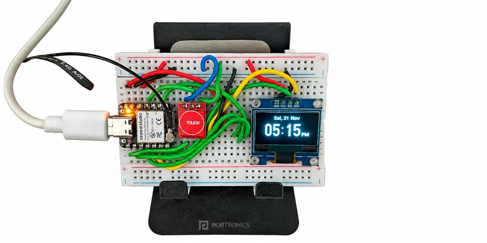
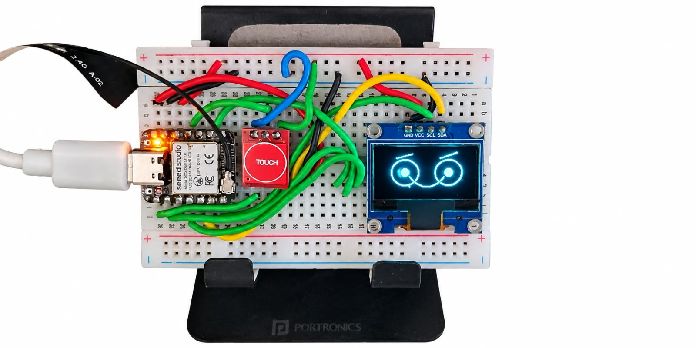
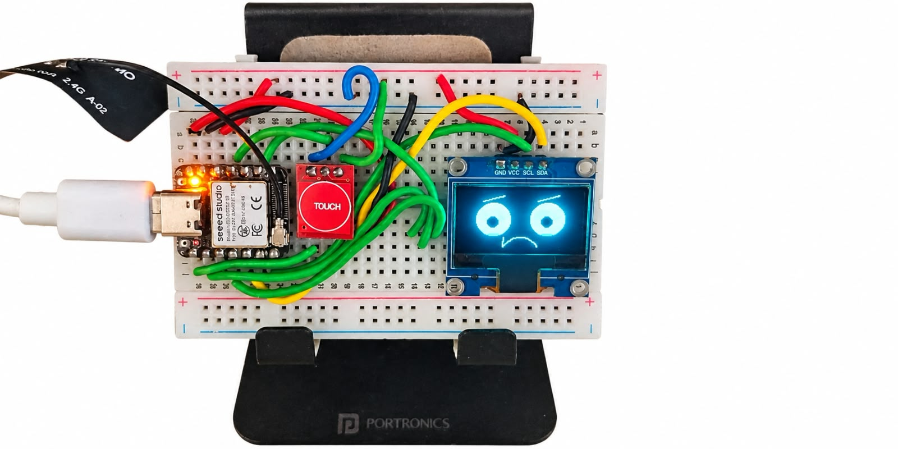

# Desk-Companion

[](Firmware/Desk-Companion-XIAO-ESP32-C3.ino)
[](Firmware/Desk-Companion-XIAO-ESP32-S3.ino)
[](https://www.arduino.cc/)
[](LICENSE)

### Your intelligent little desktop companion 🤖

**An open-source ESP32 desktop companion featuring 66 animated emotions, live weather, a smart clock, capacitive touch controls, and a professional web dashboard.**

Designed and developed by **Rayyan Sharfaz Sait**, one of the founders of **Robonavigators**.

## About

Desk-Companion is an interactive desktop device powered by the Seeed Studio XIAO ESP32-C3 or the XIAO ESP32-S3.

It combines a 128×64 OLED display, expressive facial animations, touch interactions, weather updates, and a built-in web dashboard.

The project is designed to be affordable, customizable, and beginner-friendly.

## 📸 Project Gallery

Real photos of the Desk-Companion prototype featuring the Seeed Studio XIAO board, touch sensor, and OLED display.

| Prototype view 1 | Prototype view 2 | Prototype view 3 |
|:---:|:---:|:---:|
|  |  |  |

## Current production firmware

The firmware under `Firmware/` is the **real board-specific firmware** compiled by GitHub Actions and published to the Web Flasher. The standalone browser demo is not used as firmware, and the embedded dashboard makes real device API requests (it does not simulate device responses).

Both XIAO ESP32-C3 and ESP32-S3 firmware builds provide four OLED screens: **Emotions, Clock, Weather, and Forecast**. The emotion picker contains 66 expressions. The firmware includes first-boot Wi-Fi setup, weather, touch controls, the local dashboard, and ArduinoOTA support. Physical hardware behaviour still requires testing.

On configured devices, the Desk-Companion startup logo remains visible while connecting to saved Wi-Fi. If neither network connects within the 30-second recovery window, the OLED displays Wi-Fi recovery instructions. First-time devices continue to show the setup portal instructions. During Wi-Fi recovery, triple-tap the touch sensor to dismiss the recovery instructions and return to normal OLED screens while the recovery hotspot and reconnection attempts remain active. The instructions reappear during a new outage.

## Features

- 66 animated facial emotions
- Automatic emotion switching
- Live weather and 3-day forecast
- Location-based clock with NTP synchronization
- Capacitive touch controls
- Deep-sleep functionality
- Professional responsive web dashboard
- Responsive local web dashboard controls
- Searchable emotion controls (mobile keyboard should activate only when the Search field is tapped)
- Dual Wi-Fi profiles with automatic reconnection
- Wi-Fi scanning (including nearby-network signal strength)
- Open Wi-Fi access point and captive portal
- Local dashboard at `desk-companion.local`
- ESP32 chip temperature monitoring
- Connection checks every 4 seconds
- NVS persistent configuration
- ArduinoOTA updates over the local network (using Arduino IDE or compatible tooling)

No external speaker or amplifier is required.

## Supported Boards

| Board | Support |
|---|---|
| Seeed Studio XIAO ESP32-C3 | Dedicated firmware |
| Seeed Studio XIAO ESP32-S3 | Dedicated firmware |

## Hardware Requirements

| Component | Quantity |
|---|---:|
| XIAO ESP32-C3 or ESP32-S3 | 1 |
| SSD1306 128×64 I²C OLED | 1 |
| TTP223 touch sensor | 1 |
| Jumper wires | As required |
| USB data cable | 1 |
| Enclosure | Optional |

## Wiring

### OLED Display

| OLED | XIAO |
|---|---|
| VCC | 3.3V |
| GND | GND |
| SDA | SDA |
| SCL | SCL |

### Touch Sensor

| TTP223 | ESP32-C3 | ESP32-S3 |
|---|---|---|
| VCC | 3.3V | 3.3V |
| GND | GND | GND |
| OUT | D1 / GPIO3 | D10 / GPIO9 |

Always check the board-specific GPIO configuration before connecting components.

---

## Installation

Desk-Companion provides two installation methods depending on your experience level.

| Method | Difficulty | Recommended For |
|---|---|---|
| Web Flash | Beginner | First-time builders |
| Arduino IDE | Intermediate | Developers and advanced users |

## 🚀 Install Firmware via Web Flasher

**Recommended for beginners.** Install Desk-Companion directly from a compatible desktop browser, without installing Arduino IDE or manually downloading firmware binaries.

**[⚡ Flash Desk-Companion Online](https://robonavigators-io.vercel.app/tools/flash/)**

### Supported firmware builds

| Board | Build |
|---|---|
| **Seeed Studio XIAO ESP32-C3** | ESP32-C3 firmware |
| **Seeed Studio XIAO ESP32-S3** | ESP32-S3 firmware |

ESP Web Tools detects the connected ESP32 chip family and uses the multi-build JSON manifest to select the compatible firmware image. Installation requires the corresponding compiled images and manifest to be published in the Web Flasher; source files alone cannot be flashed directly through the browser.

### Installation steps

1. Connect your **XIAO ESP32-C3** or **XIAO ESP32-S3** to your computer with a **USB data cable**.
2. Open the [Robonavigators Web Flasher](https://robonavigators-io.vercel.app/tools/flash/) using desktop **Google Chrome** or **Microsoft Edge**.
3. Click **Click to Show Firmwares**.
4. Select **Desk-Companion**.
5. Click **Install**.
6. Select the correct **USB serial device** when prompted.
7. Follow the on-screen instructions until flashing completes; keep the board connected.
8. Restart the board if necessary, then follow the OLED instructions for first-time Wi-Fi setup.

### Web Flasher troubleshooting

- **Device not found:** Use a USB data cable (not a charge-only cable) and try a different USB port.
- **Browser cannot connect:** Use current desktop Chrome or Edge, which support Web Serial.
- **Serial port busy:** Close Arduino IDE Serial Monitor and any other software using the port.
- **Installation does not start:** Reconnect the board; if needed, use its documented bootloader/download-mode procedure.

Developers who want to modify firmware can use the Arduino IDE instructions below.

### Method 2 — Arduino IDE (Intermediate)

**Recommended for users who want to explore, modify, or develop Desk-Companion's firmware.**

#### Step 1 — Install Arduino IDE

Download Arduino IDE 2.x:

https://www.arduino.cc/en/software

#### Step 2 — Install ESP32 Board Support

Open Arduino IDE and navigate to:

`File → Preferences`

Add this Boards Manager URL:

```text
https://espressif.github.io/arduino-esp32/package_esp32_index.json
```

Then open:

`Tools → Board → Boards Manager`

Search for **esp32** and install the Espressif ESP32 board package.

#### Step 3 — Install Libraries

Install the following libraries through Arduino IDE's Library Manager:

- U8g2
- ArduinoJson
- NTPClient

The ESP32 Arduino core provides additional system libraries, including WiFi, WebServer, DNSServer, ESPmDNS, Preferences, ArduinoOTA, and Wire.

#### Step 4 — Download Firmware

Select the appropriate source file:

```text
Firmware/
├── Desk-Companion-XIAO-ESP32-C3.ino
└── Desk-Companion-XIAO-ESP32-S3.ino
```

- [XIAO ESP32-C3 firmware](Firmware/Desk-Companion-XIAO-ESP32-C3.ino)
- [XIAO ESP32-S3 firmware](Firmware/Desk-Companion-XIAO-ESP32-S3.ino)

#### Step 5 — Configure the Board

1. Connect the XIAO board with a USB data cable.
2. Select the correct board in Arduino IDE.
3. Select its serial port.
4. Open the corresponding `.ino` file.

#### Step 6 — Compile and Upload

1. Click **Verify** to compile the firmware.
2. Resolve any missing libraries or compilation errors.
3. Click **Upload**.
4. Restart the board after flashing.

For troubleshooting, use Serial Monitor at **115200 baud**.

---

## First-Time Setup

Desk-Companion creates an open Wi-Fi hotspot:

```text
Desk-Companion-XXXX
```

The final four hexadecimal characters are derived from the device's Wi-Fi MAC address.

For example, if the last two MAC address bytes are `57:B9`, the hotspot name is:

```text
Desk-Companion-57B9
```

### Configure the Device

1. Connect to the Desk-Companion hotspot.
2. The captive portal may appear automatically.
3. Otherwise, open `http://192.168.4.1`.
4. Scan for nearby Wi-Fi networks.
5. Configure Primary Wi-Fi.
6. Optionally configure Secondary Wi-Fi.
7. Configure location and weather settings.
8. Save your configuration.

Wi-Fi settings are stored in NVS and survive device restarts.

The OLED displays setup instructions on first use and shows Wi-Fi recovery instructions after a previously configured device has been offline for approximately 30 seconds. Initial setup completes once a saved network connects successfully.

## OLED Startup

The startup screen uses the U8g2 `logisoso16` font:

```text
DESK
COMPANION
```

## Web Dashboard

Once connected to your local network, open:

**http://desk-companion.local**

When connected directly to the device hotspot:

**http://192.168.4.1**

The dashboard provides:

- Device status and uptime
- Nearby-network signal strength during Wi-Fi scanning
- ESP32 CPU temperature
- Four-second connection monitoring
- OLED screen switching
- Searchable emotion selector
- Dual Wi-Fi configuration
- Network scanning
- Weather and location configuration
- Restart and sleep controls

The dashboard is embedded in the firmware source and includes HTML, CSS, JavaScript, and basic confirmation prompts.

The CPU temperature represents the ESP32's internal chip temperature, not the ambient room temperature.

mDNS hostname availability depends on the client device and network.

## Weather and Time

Desk-Companion uses OpenWeatherMap for weather information.

Configure:

- City
- State / Province
- Country
- OpenWeatherMap API key

Manual latitude and longitude entry is not required.

Desk-Companion resolves the configured location and retrieves its UTC offset from the weather service.

The clock synchronizes through NTP, using the retrieved offset to display local time.

Get an API key at:

https://openweathermap.org/

An internet connection is required for online weather updates and initial time synchronization.

## OLED Screens

| Screen | Function |
|---|---|
| Emotions | 66 expressive faces and automatic cycling |
| Clock | Local date and time |
| Weather | Current conditions |
| Forecast | 3-day forecast |

The repository's production firmware has **four** screens. A separate five-screen development/demo concept is **not part of these compiled builds**. The real embedded dashboard uses device API endpoints rather than an offline mock.

### Emotion Selector

Use the dashboard's emotion selector to pick a face, or select **Automatic** to cycle expressions. The dashboard and its API are served by the ESP32, not by a separate demo page.

### Touch Controls

| Action | Result |
|---|---|
| Short touch | Switch screens |
| Long touch | Enter deep sleep |
| Wake touch | Wake where supported |

## Architecture

```text
                 Desk-Companion
                        |
               XIAO ESP32-C3/S3
                        |
       +----------------+----------------+
       |                |                |
    OLED Display    Touch Sensor      Wi-Fi
       |                |                |
    Emotions         Navigation       STA / AP
    Clock            Deep Sleep       Captive Portal
    Weather                           WebServer
    Forecast                          mDNS / ArduinoOTA
                        |
                    NVS Storage
                        |
                Saved Configuration
                        |
                OpenWeatherMap / NTP
```

## Repository Structure

```text
Desk-Companion/
├── Firmware/
│   ├── Desk-Companion-XIAO-ESP32-C3.ino
│   ├── Desk-Companion-XIAO-ESP32-S3.ino
├── assets/
│   ├── desk-companion-demo-01.jpeg
│   ├── desk-companion-demo-02.jpeg
│   └── desk-companion-demo-03.jpeg
├── README.md
└── LICENSE
```

The dashboard is embedded in each board-specific firmware sketch. The `assets/` directory contains project photos.

## Troubleshooting

### Hotspot Not Appearing

Check the USB connection, board power, and installed firmware. Restart the ESP32.

### Captive Portal Not Opening

Connect to the Desk-Companion hotspot and manually open `http://192.168.4.1`.

### desk-companion.local Not Working

Check that your device and Desk-Companion are on the same network. If mDNS is unavailable, use the assigned IP address.

### OLED Not Working

Verify the display's SDA, SCL, VCC, and GND connections and its I²C configuration.

### Weather Not Updating

Check internet connectivity, API key, and configured location.

### Incorrect Clock Time

Verify NTP connectivity and the configured location.

## Security

Desk-Companion currently uses an open setup hotspot and password-free dashboard.

Anyone who can connect to the hotspot or access its web server may be able to control the device or modify settings.

Use the project on trusted networks and do not expose its HTTP or OTA services to the public internet.

Do not commit Wi-Fi passwords, API keys, or other personal information to the repository.

## Development Status

The C3/S3 four-screen sketches in `Firmware/` are the source of truth for GitHub Actions firmware builds and the Web Flasher. Demo/development files stored outside this repository do not affect released binaries. GitHub Actions compilation alone does not prove physical-device behaviour, so verify on hardware before wider distribution.

## Contributing

Contributions, suggestions, bug reports, and documentation improvements are welcome.

When reporting issues, include the board model, firmware version, relevant logs, and steps to reproduce the problem.

Never include private credentials in issues or screenshots.

## License

**Desk-Companion is licensed under the MIT License.**

You may use, modify, and distribute the project under the terms of the MIT License, including its requirement to retain the copyright and permission notices.

See [LICENSE](LICENSE) for the complete license text.

Third-party dependencies retain their respective licenses.

## Credits

**Desk-Companion — By Robonavigators**

Built using the Seeed Studio XIAO ESP32 platform, Arduino framework, U8g2, and OpenWeatherMap.

**Build and Designed by Rayyan Sharfaz Sait**.
---

**Desk-Companion — Your desk. Your companion. Your creativity.**

Made by **Robonavigators**.


## Firmware distribution and updates

Development changes to the production sketches automatically compile both ESP32-C3 and ESP32-S3 firmware through GitHub Actions. Successful builds publish **merged USB installation images** to the Robonavigators Web Flasher. These files are for USB flashing, not in-device GitHub OTA installation.

The automatic GitHub stable-release checker, OLED update notice, dashboard **Install update** button, and GitHub OTA application-image publication workflow have been removed. Desk-Companion no longer checks GitHub releases or installs updates directly from its dashboard.

**ArduinoOTA remains supported** for local-network firmware uploads using developer tools with the correct board configuration and existing device OTA authentication. Alternatively, use the [Robonavigators Web Flasher](https://robonavigators-io.vercel.app/tools/flash/) over USB. The two methods are separate.

